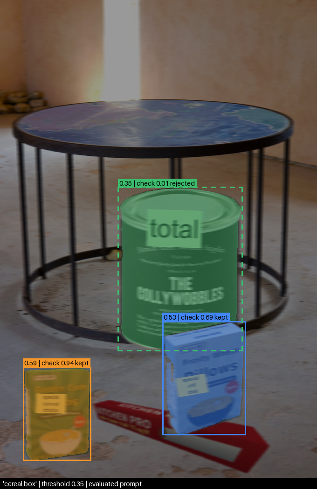

# CST 620 Week 4: Vision-Language Pipeline for Retail Inspection

A proof of concept for shelf inspection with no per-product training. You type a description such as `cereal box` or `damaged cereal box`, and the pipeline returns boxes and masks. It chains three pretrained models, runs on CPU, and is evaluated zero-shot on a held-out split that was scored exactly once.

The course scenario asks whether this approach is ready for production. The answer from the test run: it finds cereal boxes reliably (precision and recall 0.99), but it cannot yet be trusted to tell a dented box from an intact one (recall 0.28), and it does not detect crooked labels at all.



*Prompt `cereal box` on a showcase image, which is never scored. Two cereal boxes are kept. Grounding DINO also proposed the tin can at 0.35, and the CLIP check rejected it.*

## How it works

| Step | Model | Job |
|---|---|---|
| 1 | Grounding DINO (`IDEA-Research/grounding-dino-tiny`) | Proposes boxes from the text prompt |
| 2 | SAM (`facebook/sam-vit-base`) | Draws a mask inside each box. It never sees the text |
| 3 | CLIP (`openai/clip-vit-base-patch32`) | Checks each crop against a contrast pair, such as a dented box against an undamaged one, and drops the box when the margin is too small |

No model is trained or fine-tuned. The three steps are in [src/pipeline.py](src/pipeline.py).

## Results

The test split has 30 composite images. It was scored once, on 2026-10-05, with settings chosen on the validation split and frozen beforehand: detection threshold 0.35, CLIP check margin 0.0, CLIP check temperature 1.25.

| Category | Prompt | Precision | Recall | F1 | mIoU of matches |
|---|---|---|---|---|---|
| `cereal_box` | cereal carton | 0.99 (96 of 97) | 0.99 (96 of 97) | 0.99 | 0.955 |
| `damaged_cereal_box` | damaged cereal box | 0.46 (11 of 24) | 0.28 (11 of 39) | 0.35 | 0.953 |
| `misaligned_label` | crooked sticker | 0.00 (0 of 20) | 0.00 (0 of 38) | 0.00 | none matched |

A detection counts as correct when its mask overlaps a ground-truth mask with IoU of 0.5 or more. Macro F1 is 0.446 with the CLIP check and 0.462 without it.

What the numbers show:

- **Finding the product works.** One cereal box in 97 was missed and one detection in 97 was wrong. The CLIP check removed 28 of the 29 false positives that Grounding DINO proposed, which raised precision from 0.77 to 0.99.
- **The detector mostly ignores the word "damaged".** Without the CLIP check, the prompt `damaged cereal box` put a box on 56 of the 58 intact boxes (97%, Wilson 95% interval 88% to 99%). In the one probe saved in [results/probe/](results/probe/), the word "damaged" scored 0.09 while "box" scored 0.72, and the box score is the highest single word score.
- **The CLIP check trades one error for another.** It cut that false-alarm rate to 13 of 58 intact boxes (22%, interval 14% to 35%), but it also rejected 28 of the 39 truly dented boxes, so recall fell from 1.00 to 0.28.
- **Crooked labels are not detected.** Grounding DINO produced no matching box for 37 of the 38 misaligned labels, and all 20 boxes the pipeline reported were wrong.
- **SAM is not the weak stage.** Given ground-truth boxes, its masks reach mIoU 0.92 to 0.96, and no error was attributed to it.
- **Wording changes the outcome.** For `cereal_box` with the CLIP check off, "box of cereal" found 68% of the boxes, while "cereal box" and "cereal carton" found all of them.
- **Dent size did not behave as expected.** With the CLIP check on, recall was 0.75 on subtle dents (9 of 12) and 0.07 on clear dents (2 of 27). All the subtle dents come from one product, so this may say more about that product than about dent size.
- **Runtime is slow on CPU.** The test run took about 55 minutes for 30 images with 12 threads. Grounding DINO takes most of it, 95 seconds per image, because every image is run against all nine prompt wordings.

Full tables are in [results/test/](results/test/), including per-wording metrics with intervals ([sensitivity.csv](results/test/sensitivity.csv)), the stage-by-stage error table ([stage_table.csv](results/test/stage_table.csv)), calibration, and an overlay image for each of the 101 failures. The executed report with figures is [notebooks/report.ipynb](notebooks/report.ipynb).

## How the evaluation is protected

- **Splits are by product, not by image.** An intact box and its dented twin always land in the same split, and every background and cutout belongs to exactly one split (seed 42). The splits are val (20 images), test (30) and showcase (6, for demos only).
- **Every choice is made on val.** [src/tune_val.py](src/tune_val.py) picks the detection threshold, the headline wording per category, and the CLIP check temperature and margin, then writes [frozen.json](frozen.json).
- **The test run cannot drift from what was frozen.** [src/eval.py](src/eval.py) refuses to run if the val list, `prompts.yaml`, `config.yaml` or the model fingerprint no longer match the hashes in `frozen.json`.
- **Test is scored once.** Each run is logged in [results/test_runs.log](results/test_runs.log), and a second run is refused unless it is given a written reason. All nine wordings are run and reported; the headline wording was fixed before the run, not picked from test.
- **Ground truth is never model-assisted.** It is the exact paste mask written when each composite is built. Cutouts come from the renderer's own masks or from rembg, never from SAM, so SAM is not graded against its own edges.
- **Leakage is audited.** [src/check_splits.py](src/check_splits.py) runs 19 checks; the result is in [results/check_splits.txt](results/check_splits.txt).
- **Every rate has an interval.** Precision, recall and the false-alarm rates use Wilson 95% intervals. F1 and mIoU use an image-level bootstrap.

## Data

The source set is in [data/raw/synthetic/synthetic_retail_set/](data/raw/synthetic/synthetic_retail_set/) and has 45 images:

- 10 invented cereal brands, each rendered as a 3D box once intact and once dented (20 images)
- 3 rendered look-alike boxes (tea, tissue, foil)
- 6 real distractor objects and 16 backgrounds from Open Images, licensed CC BY 2.0

[src/make_synth.py](src/make_synth.py) pastes product cutouts and drawn labels onto the backgrounds to build each split, and writes the exact masks as COCO annotations. Straight labels are rotated 0 to 2 degrees and misaligned labels 8 to 25 degrees.

There are no camera photos in this project. Credits for the Open Images photos are in [ATTRIBUTION.csv](data/raw/synthetic/synthetic_retail_set/ATTRIBUTION.csv).

## Limitations

- **The data is synthetic.** The boxes are clean renders of invented brands, the dents are simulated, and the labels are drawn rectangles. The results describe this set, not real shelves.
- **"Held out" is partial.** The boxes and labels in test are new, but the backgrounds and real distractors are public Open Images photos that the pretrained models may have seen.
- **The models may be reading.** The rendered boxes print the word "Cereal" and the look-alikes print their own product names.
- **The sample is small.** Test has 30 images and 4 cereal-box products, so the intervals are wide.
- **One machine.** Everything was run on a single Windows CPU.

## Running it

Requirements: Windows, PowerShell, Python 3.12, CPU. Package versions are pinned in [requirements.txt](requirements.txt).

```powershell
python -m venv .venv
.\.venv\Scripts\python.exe -m pip install -r requirements.txt
```

Download the three models into the local Hugging Face cache once, then confirm they load offline:

```powershell
.\.venv\Scripts\hf.exe download IDEA-Research/grounding-dino-tiny
.\.venv\Scripts\hf.exe download facebook/sam-vit-base
.\.venv\Scripts\hf.exe download openai/clip-vit-base-patch32
.\.venv\Scripts\python.exe src\models.py --check
```

`eval.py` compares the model commits, library versions and thread count against `frozen.json`, which lists the commits it expects. If a model has been updated on the Hub since, `eval.py` will refuse to run.

The cutouts and composite images are not stored in this repository, only their manifests and annotations. The build order is:

```powershell
.\.venv\Scripts\python.exe src\cutouts.py
.\.venv\Scripts\python.exe src\data.py
.\.venv\Scripts\python.exe src\make_synth.py --split all --verify
.\.venv\Scripts\python.exe src\make_synth.py --split all --force
.\.venv\Scripts\python.exe src\check_splits.py
```

The `--verify` step regenerates every image in memory and compares it with the md5 values in the tracked manifests, so it shows whether your rebuild matches the images that were scored. The `--force` step then writes the images. This rebuild has not been tested from a fresh clone. The drawn labels use `C:/Windows/Fonts/arial.ttf`, so a matching rebuild needs Windows.

Then:

```powershell
.\.venv\Scripts\python.exe -m pytest tests
.\.venv\Scripts\python.exe src\demo.py --image s_showcase_0005 --prompt "cereal box" --open
.\.venv\Scripts\python.exe src\probe.py --image s_showcase_0000 --family cereal_box_attribute
.\.venv\Scripts\python.exe src\eval.py --dry-run
```

- `pytest` runs 33 unit tests for the metrics, using hand-worked values.
- `demo.py` writes an overlay PNG and a JSON file to `results/demo/`. It accepts showcase images, or your own photo placed in `data/showcase_live/`.
- `probe.py` reproduces one false alarm with per-word scores.
- `eval.py --dry-run` runs the full scoring code on 3 val images and never touches test. Plain `eval.py` will refuse, because a completed test run is already logged.

## Repository layout

| Path | What it holds |
|---|---|
| [src/models.py](src/models.py) | Loads the three models once and fingerprints the setup |
| [src/cutouts.py](src/cutouts.py) | Makes product cutouts with clean masks |
| [src/data.py](src/data.py) | Inventories the sources, groups duplicates and splits asset groups once |
| [src/make_synth.py](src/make_synth.py) | Builds the composite images and their exact masks |
| [src/check_splits.py](src/check_splits.py) | Audits the splits for leakage |
| [src/pipeline.py](src/pipeline.py) | Grounding DINO, then SAM, then the CLIP check |
| [src/metrics.py](src/metrics.py) | Matching, IoU, precision and recall, intervals, calibration error |
| [src/tune_val.py](src/tune_val.py) | Makes every selection on val and writes `frozen.json` |
| [src/eval.py](src/eval.py) | Scores test once with `frozen.json` |
| [src/demo.py](src/demo.py) | Prompt in, overlay PNG and JSON out |
| [src/probe.py](src/probe.py) | Reproduces a false alarm and shows which words drove it |
| [tests/](tests/) | Unit tests for the metrics |
| [notebooks/report.ipynb](notebooks/report.ipynb) | The executed report: tables and figures read from `results/` |
| [config.yaml](config.yaml), [prompts/prompts.yaml](prompts/prompts.yaml) | Parameters and prompt wordings, fixed before any results |
| [frozen.json](frozen.json) | The values chosen on val, with the hashes `eval.py` checks |
| [results/](results/) | The val report, the scored test run, failure overlays, demo and probe outputs |
| [data/](data/) | The source image set, asset pools, split manifests and ground-truth annotations |
| [CLAUDE.md](CLAUDE.md) | Project rules for the AI coding assistant (Claude Code) used during development |

## Notes on this repository

- Docstrings and `CLAUDE.md` refer to spec files under `docs/`. Those files are not included here.
- `frozen.json` and the `metrics.json` files record commit `5cf6471`, and `results/test_runs.log` records commit `053751b`. The history was rewritten before publishing, and those commits are now `a8b7417` and `0d8f267`. The rewrite removed the `docs/` folder and reworded one docstring line and some commit messages. No code logic, data or result file changed.
- The three models are downloaded from the Hugging Face Hub and are not redistributed here.
